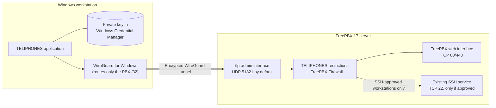
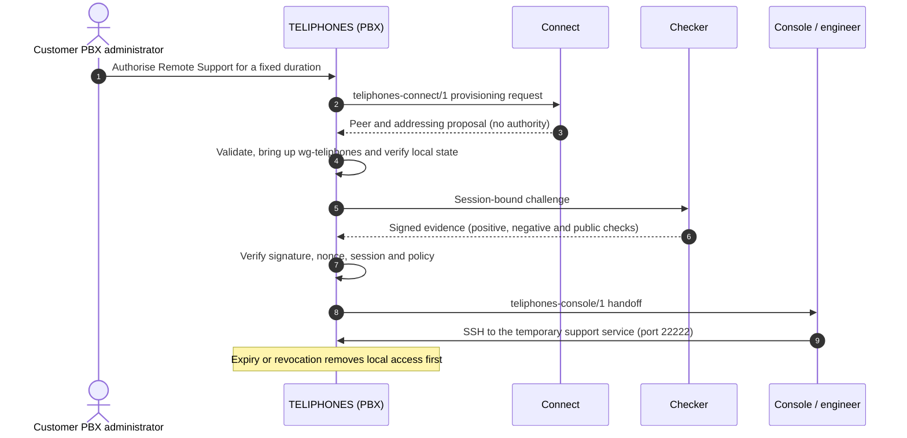
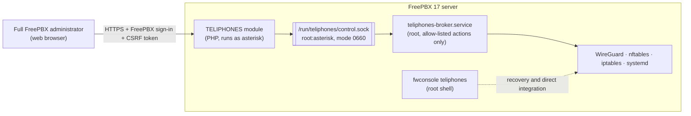
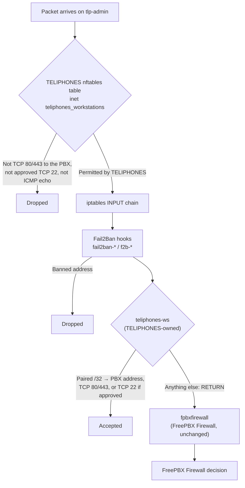
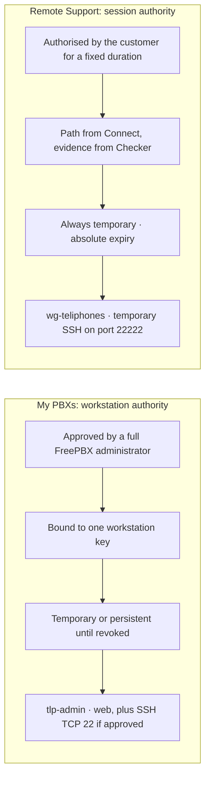

# TELIPHONES

**TELIPHONES is a UK registered trademark.**

**TELIPHONES 0.6.4 for Windows is licensed under GPLv3.**

**TELIPHONES 0.3.5 for FreePBX is licensed under GPLv3.**

GPLv3 licensing applies to the software and does not grant trademark rights.

**Administrator-authorised remote connectivity for FreePBX.** TELIPHONES pairs administrators' Windows workstations with their own FreePBX systems over narrowly restricted WireGuard tunnels. It also manages separately authorised, time-limited remote support sessions for managed service providers (MSPs). Every connection is authorised, restricted, monitored and revoked on the PBX itself.

> [!WARNING]
> **TELIPHONES 0.3.5 is an unreleased experimental development correction and is not suitable for production PBXs.**
>
> Installation and the root broker bootstrap have been verified on a Debian 12 / FreePBX 17 test system. The operator reports that Windows 0.4.0 establishes a WireGuard tunnel and PuTTY reaches SSH, but SSH key authentication is not yet configured. A broker ownership correction for Debian 12 nftables 1.0.6 has been separately tested on the test PBX; the corrected repository package and full upgrade/recovery path still need validation. Use TELIPHONES only on disposable test systems. See [Development status](#development-status).

## Contents

- [What is TELIPHONES?](#what-is-teliphones)
- [Capabilities](#capabilities)
- [My PBXs: administrator-managed connections](#my-pbxs-administrator-managed-connections)
- [Remote Support: temporary MSP access](#remote-support-temporary-msp-access)
- [Architecture](#architecture)
- [Quick start](#quick-start)
- [Security overview](#security-overview)
- [Development status](#development-status)
- [Compatibility](#compatibility)
- [Documentation](#documentation)
- [Repository layout](#repository-layout)
- [Building and testing](#building-and-testing)
- [Release history](#release-history)
- [Contributing](#contributing)
- [Support](#support)
- [Licence](#licence)
- [Author](#author)

## What is TELIPHONES?

TELIPHONES is a FreePBX connectivity and remote-access management project. It has three parts:

| Component | What it is | Where it runs |
|---|---|---|
| **FreePBX module** (`teliphones`) | Adds **Connectivity > TELIPHONES** to FreePBX, together with the `fwconsole teliphones` command. Administrators use it to approve, inspect and revoke access. | The FreePBX server |
| **Privileged broker** | A small, root-owned service that performs the network operations the web interface is not permitted to perform: WireGuard, nftables, iptables and systemd. It accepts requests only from the FreePBX service account. | The FreePBX server |
| **Windows application** | A native Windows 10/11 client that pairs with a PBX, holds its own WireGuard key and opens FreePBX or SSH through the tunnel in the browser and SSH terminal the user prefers. | Administrator and engineer workstations |

An optional, separate [reference gateway](gateway/README.md) demonstrates the MSP connectivity contracts in a disposable laboratory. It is not part of the FreePBX module.

### Why it exists

Remote access to a phone system is often achieved in ways that are convenient but difficult to control:

- publishing the FreePBX administration interface or SSH to the Internet;
- broad VPNs that place a whole network, rather than one service, within reach;
- support credentials shared with a provider indefinitely;
- firewall exceptions that are added for an incident and never removed;
- no clear record of who may connect, to what, and until when.

TELIPHONES replaces these with explicit, per-workstation and per-session authority that the PBX owner grants and can withdraw at any time.

### What problems it solves

- **Reaching your own PBX safely.** A paired workstation can reach the FreePBX web interface through WireGuard, without publishing the interface publicly. SSH is available only if you allow it for that workstation.
- **Coexisting with FreePBX Firewall.** Version 0.3.0 introduced a narrow, TELIPHONES-owned integration that admits only approved traffic and preserves Fail2Ban. Its nftables table-comment ownership marker was not visible through Debian 12 nftables 1.0.6 JSON readback. Version 0.3.1 replaces it with a hookless ownership chain and constrains migration to an exact known policy while the interface is down. The operator reports testing this ownership correction on the FreePBX 17 test PBX.
- **Granting support without permanent access.** A customer can authorise an MSP for a fixed period. The support path must be independently checked before it is used, and it is removed on expiry or revocation.

### Who it is for

| Audience | How TELIPHONES helps |
|---|---|
| **FreePBX administrators** | Reach the PBXs you manage from a known Windows workstation, with access limited to what you approve. |
| **MSPs and support providers** | Use a consistent, auditable, customer-approved process for temporary support access. |
| **PBX owners and customers** | Decide who can connect, for how long and to which services, and revoke access from the PBX itself. |
| **Integrators and developers** | Implement the published, provider-neutral Connect, Checker and Console contracts using your own infrastructure. |

### How it relates to FreePBX

TELIPHONES is a FreePBX 17 module. It is installed through **Admin > Module Admin**, appears under **Connectivity > TELIPHONES**, uses the existing FreePBX administrator sign-in and adds `fwconsole teliphones`.

TELIPHONES does not replace or reconfigure FreePBX Firewall. It does not change FreePBX Firewall zones, trusted networks, chains or services, and it never asks you to disable FreePBX Firewall or weaken SSH. TELIPHONES is a community module maintained by FreePBX UK. It is not distributed through the FreePBX online module repository.

### How it differs from conventional remote access

| Conventional approach | TELIPHONES |
|---|---|
| Access is granted by network location or a shared VPN profile. | Access is granted to an individual WireGuard key, approved by a FreePBX administrator on the PBX. |
| A VPN typically reaches a whole subnet. | The workstation routes only the PBX's single tunnel address (`/32`). The PBX does not forward workstation traffic onwards. |
| The firewall is opened, or disabled, to make access work. | Only TCP 80/443, and TCP 22 when explicitly approved, are admitted from each paired address. All other traffic continues through FreePBX Firewall. |
| Support access lasts until someone remembers to remove it. | Support sessions have a fixed absolute expiry. Temporary pairings expire on the PBX, and persistent pairings are revocable at any time. |
| The client decides when it is connected. | The PBX is authoritative. Deleting a client profile does not revoke access; revoking on the PBX does. |

## Capabilities

| Capability | Description | Status in 0.3.5 |
|---|---|---|
| Windows workstation pairing | Key-bound request and response exchange, approved by a full FreePBX administrator over HTTPS | Operator reports a working Windows 0.4.0 tunnel to the FreePBX 17 test PBX |
| Temporary and persistent pairing | Pairings expire on the PBX after 60, 240, 480 or 1440 minutes, or persist until revoked | Implemented |
| Per-workstation SSH permission | TCP 22 is admitted only for workstations explicitly approved for SSH, using existing PBX credentials | PuTTY reaches SSH in operator testing; public-key authentication not completed |
| Revocation | Revoke one workstation or all workstations; revocation is reported only once verified | Implemented |
| Isolated nftables enforcement | An ownership-marked `inet teliphones_workstations` table, verified in full and monitored for external changes | 0.3.1 uses a hookless ownership chain; operator-tested on the PBX and covered by local regressions |
| FreePBX Firewall integration | A broker-owned `teliphones-ws` iptables chain placed immediately before FreePBX Firewall and after Fail2Ban | 0.3.0 ownership defect corrected in 0.3.1; operator reports the ownership hotfix was tested on the live test PBX; repository package/bootstrap retest pending |
| Correlated session diagnostics | Bounded local Windows and root-broker timelines, selected-pairing views and administrator-only export | Added in Windows 0.5.1 / module 0.3.2; local regressions only, native/live validation pending |
| Fail2Ban compatibility | Recognises `fail2ban-*` and `f2b-*` hooks; withdraws the integration rather than bypass Fail2Ban | Implemented in 0.3.0; simulated reload tests, further live verification outstanding |
| Automatic reconciliation | Restores the integration after firewall reloads, without duplicate rules | New in 0.3.0; simulated tests only |
| Connectivity diagnostics | Shows the last WireGuard handshake and integration state, and warns when a handshake succeeds but integration is inactive | New in 0.3.0 |
| Live status monitoring | Shows progress for broker operations without reloading the page | Implemented |
| Remote support authority (On-PBX) | Root- or GUI-authorised sessions with absolute expiry, local verification, signed Checker evidence and a temporary SSH service | Implemented; not yet validated end to end |
| Connect, Checker and Console contracts | Provider-neutral integration interfaces for MSP infrastructure | Contracts published; reference implementations are lab-only |
| On-net and Off-net topologies | Support paths terminating elsewhere on, or outside, the customer network | Contract definitions only |
| Relay or NAT traversal | Reaching PBXs whose WireGuard port cannot be reached directly | Not implemented ([design note](docs/RENDEZVOUS.md)) |

## My PBXs: administrator-managed connections

This workflow connects an administrator's own Windows workstation to a FreePBX system they manage. It does not need the reference gateway, an MSP or any external service.



*The workstation sends only traffic for the PBX's tunnel address through WireGuard. On the PBX, the traffic arrives on the dedicated `tlp-admin` interface. TELIPHONES' restrictions admit only the FreePBX web interface, and SSH only when it has been approved for that workstation.*

**How it works**

1. **Request.** In the Windows application, choose **Add my PBX...** and **Generate request**. The application creates a WireGuard key pair locally and keeps the private key in Windows Credential Manager. The request contains only the public key, a workstation name and a random nonce.
2. **Approve.** A full FreePBX administrator pastes the request into **Connectivity > TELIPHONES > Windows workstations** over HTTPS. They choose the access period and whether SSH is permitted, then select **Pair workstation**.
3. **Complete.** The administrator copies the pairing response back into the waiting Windows dialog. The application checks that the response is bound to its own request and key before saving it.
4. **Connect.** Selecting **Connect** installs a Windows tunnel service, which requires UAC approval. **Open FreePBX** then opens the administration interface through the tunnel, where you sign in with your existing FreePBX credentials.

**Pairing is not the same as connection.** A pairing is the PBX's standing authorisation for one workstation key. A connection is the tunnel that the workstation brings up while it needs access. You can disconnect and reconnect a paired workstation as often as required without approving it again. Revoking the pairing on the PBX removes the authorisation itself.

| Access period | Behaviour |
|---|---|
| **Temporary** | Expires on the PBX after the selected duration (60, 240, 480 or 1440 minutes). Expiry is never extended by reconnecting, restarting the broker or upgrading. |
| **Persistent trusted workstation (until revoked)** | Remains valid until an administrator revokes it. Persistent pairings are subject to the same firewall verification as temporary pairings. |

| Permission | Behaviour |
|---|---|
| Web interface | Always included: TCP 80 and 443 to the PBX's tunnel address. |
| SSH | Only when the administrator selects **Permit SSH (TCP 22) with existing PBX credentials**. Pairing creates no accounts, passwords or SSH keys. |

Revocation is performed on the PBX with **Revoke** or **Revoke all workstations**. Deleting the Windows profile only deletes the local key; it does not revoke the PBX's authorisation.

➡️ Step-by-step guide: [Windows workstations: install, pair and connect](teliphones/README.md#windows-workstations-install-pair-and-connect). Protocol details: [workstation pairing contract](teliphones/docs/WORKSTATION-PAIRING.md).

## Remote Support: temporary MSP access

This workflow allows a customer's PBX administrator to grant a support provider temporary, independently verified access. It is entirely separate from workstation pairing and uses its own interface (`wg-teliphones`), addresses and SSH service.

TELIPHONES defines three replaceable integration roles and keeps the final decision on the PBX:

> **Connect creates. Checker observes. Console consumes. TELIPHONES decides.**

| Role | Responsibility | Cannot |
|---|---|---|
| **TELIPHONES** (on the PBX) | Creates the authorisation and its absolute expiry, verifies local state, evaluates Checker evidence, opens and closes the temporary SSH service and revokes access | — |
| **Connect** | Creates the network path between the PBX and the support provider | Authorise, extend or activate a session by itself |
| **Checker** | Independently observes the path from outside and returns signed evidence | Declare a session safe; TELIPHONES evaluates the evidence |
| **Console** | Consumes approved access for the support engineer | Authorise itself or extend the session |



*The customer authorises the session on their own PBX. Connect builds the path, but no engineer access is opened until TELIPHONES has verified the local state and accepted independently signed Checker evidence. The session ends at its original expiry or when revoked, whichever is sooner.*

**Intended benefits**

- **Customers** approve each support window, can see its status and can revoke it immediately from FreePBX.
- **MSPs** get a repeatable, evidence-based procedure in place of standing credentials or ad-hoc firewall changes.
- **Support engineers** use standard WireGuard, browser and SSH tools, and access is bound to their individually enrolled key.

**What exists today**

| Element | Status |
|---|---|
| PBX-side session authority, expiry, revocation, local verification and Checker evidence validation | Implemented in the module; automated tests only |
| On-PBX topology with a temporary, hardened SSH service on port 22222 | Implemented; not yet validated on a real PBX |
| `teliphones-connect/1`, `teliphones-checker/1` and `teliphones-console/1` | Published contracts |
| [Reference gateway](gateway/README.md) (Connect) and Checker probe | Lab reference implementations for disposable systems; not production services |
| Console | Handoff contract only; no engineer portal is supplied |
| Windows application **Remote Support...** profiles | Implemented; imports operator-issued grants; not yet validated end to end |
| Managed Connect, Checker or Console services | Not supplied |

The MSP workflow has **not** completed production or end-to-end validation.

➡️ Operating guide: [Remote Support](teliphones/README.md#remote-support-browser-workflow). Contracts: [integration guide](teliphones/docs/INTEGRATION.md).

## Architecture

### Administration and privilege separation



*The web interface authenticates the administrator and validates each request, but never performs privileged operations itself. It sends allow-listed requests over a local socket that only the FreePBX service account can use. The root-owned broker carries them out. The broker is installed once from a root shell, as described in the [root bootstrap](teliphones/README.md#complete-installation-on-freepbx-17).*

### Firewall layering



*A packet must pass both layers. TELIPHONES' nftables table drops everything on `tlp-admin` that is not explicitly permitted, and forbids forwarding to other networks. Because an nftables accept cannot override a later FreePBX Firewall drop, the broker also maintains `teliphones-ws`. This chain is reached after every Fail2Ban hook and immediately before FreePBX Firewall. It accepts only the approved traffic and returns everything else to FreePBX Firewall.*

### Persistent workstation authority and temporary support authority



*The two workflows never share authority. A workstation pairing cannot open a support session, and a support session cannot create or extend a workstation pairing. Each has its own interface, address range, firewall policy and revocation.*

More detail: [architecture overview](docs/ARCHITECTURE.md).

## Quick start

> [!IMPORTANT]
> Use a disposable Debian 12 / FreePBX 17 test system. Never test TELIPHONES 0.3.5 on a production PBX.

1. **Prepare the PBX.** Confirm that `wg`, `ip` and `nft` are available. The `nftables` package is required for the `nft` command, but `nftables.service` does not need to be enabled. If `wg` is missing, you can approve installation of `wireguard-tools` from the GUI after step 3; other prerequisites must be installed by a root administrator.
2. **Install the module.** Verify the archive's checksum, then upload `TELIPHONES-0.3.5.tgz` through **Admin > Module Admin** and install it.

   ```bash
   sha256sum TELIPHONES-0.3.5.tgz
   ```

3. **Install the privileged broker.** From an existing root shell on the PBX, run the [root bootstrap procedure](teliphones/README.md#complete-installation-on-freepbx-17) exactly as published. **Connectivity > TELIPHONES** shows the same commands with a **Copy Commands** button. Repeat the procedure after every TELIPHONES upgrade.
4. **Check readiness.** Open **Connectivity > TELIPHONES** over HTTPS as a full administrator. The broker should be operational, and **Windows workstations** should report its prerequisites and FreePBX Firewall integration status.
5. **Allow WireGuard to reach the PBX.** Make the PBX's WireGuard UDP port (51821 by default) reachable from the workstation, using your router, host firewall and FreePBX Firewall as appropriate. Do not publish TCP 22, 80 or 443.
6. **Prepare Windows.** Run `TELIPHONES.exe` and follow **Welcome to TELIPHONES**: choose applications, then install WireGuard if needed using **Install WireGuard** and normal administrator approval. **Not Now** lets you explore first; installation remains available in **Settings > Connectivity**. Existing verified WireGuard installations are reused. You can build TELIPHONES from [`desktop/windows/`](desktop/windows/README.md) or download it from a successful GitHub Actions run. The new [integrated installation flow](desktop/windows/README.md#secure-connectivity-and-wireguard-installation) still requires live Windows validation.
7. **Pair, connect and open FreePBX.** Follow [Windows workstations: install, pair and connect](teliphones/README.md#windows-workstations-install-pair-and-connect).

## Security overview

Security is the central design consideration for TELIPHONES. The main controls are:

- **Explicit authorisation.** Only a full FreePBX administrator, over HTTPS with CSRF protection, can pair a workstation or authorise support. Installing or enabling the module grants no access by itself.
- **Local key ownership.** Workstation private keys are generated on and remain on the workstation, in Windows Credential Manager. PBX private keys are generated on and remain on the PBX.
- **Narrow tunnels.** The workstation routes only the PBX's `/32`. The PBX drops all forwarding to and from `tlp-admin`, so a paired workstation cannot reach other networks through it.
- **Per-workstation permissions.** Each pairing admits only the web interface. SSH is admitted only for workstations explicitly approved for it, and only with existing PBX credentials.
- **Layered firewall enforcement.** TELIPHONES' own nftables policy is verified in full before any peer is admitted, and the FreePBX Firewall integration is installed only after that verification. Fail2Ban is never bypassed.
- **Revocation and expiry.** These are enforced by the PBX. Failed cleanup is reported as a failure, never as a successful revocation.
- **Privilege separation.** The web application cannot perform privileged operations. A root-owned broker carries out a fixed set of operations and accepts requests only from the FreePBX service account.
- **Fail-safe handling.** If enforcement cannot be verified, workstation access is disabled rather than left unrestricted. Unfamiliar firewall tables or chains that share TELIPHONES' names are never overwritten.

> [!CAUTION]
> **Known limitations**
>
> - TELIPHONES detects and repairs external firewall changes; it cannot prevent them. Another root process that flushes the firewall can briefly expose an active tunnel until TELIPHONES detects the change. On the iptables `legacy` backend, repair can take up to about 15 seconds.
> - A Fail2Ban hook inserted between TELIPHONES' jump and `fpbxfirewall` can be bypassed by approved tunnel traffic until reconciliation.
> - These controls are not true fail-closed or zero-exposure protection.

The full security model, its assurance levels and its limitations are described in [Security](docs/SECURITY.md).

## Development status

The table below distinguishes three levels of assurance: what has been **verified on a real system**, what has been **tested automatically or in simulation**, and what is **outstanding**.

| Area | Verified on a real system | Automated or simulated testing | Outstanding |
|---|---|---|---|
| Module Admin installation and root broker bootstrap | ✅ Debian 12 / FreePBX 17 (earlier releases); ownership hotfix operator-tested | ✅ | Validate packaged 0.3.5 upgrade, migration, diagnostics permissions, restart and recovery |
| FreePBX GUI and administrator access checks | ✅ Page operation on FreePBX 17 | ✅ Framework stubs | Delegated-user refusal on a real PBX |
| Windows application build and launch | ✅ Compiled and launched on Windows | ✅ Portable core tests | Interactive tunnel, UAC and Credential Manager testing |
| Windows browser and SSH terminal preferences | ✅ Operator reports PuTTY launches and reaches SSH in 0.4.0 | ✅ Portable core tests (selection, storage, command lines) | Other terminals, detection and complete preferences matrix |
| Integrated WireGuard installation and onboarding | — | ✅ Simulated installer flow and source checks | **MSVC build and live Windows installation, UAC, verification and recovery** |
| Workstation WireGuard handshake | ✅ Operator reports Windows 0.4.0 connects to the FreePBX 17 test PBX | — | Full lifecycle and revocation tests |
| Web access through the tunnel with FreePBX Firewall enabled | 0.3.0 blocked; operator reports testing the 0.3.1 broker ownership correction | ✅ Simulated FreePBX layout, real packets in namespaces | **Install/restart the 0.3.5 package's broker (component 0.3.2) and verify complete path** |
| FreePBX Firewall restart and reload compatibility | — | ✅ Simulated | **Outstanding** |
| Fail2Ban enforcement during rule reordering | — | ✅ Simulated with observed chain names | **Outstanding** |
| SSH through PuTTY when explicitly authorised | ✅ Server reached; public-key-only authentication rejected | ✅ Rule scope | **Approved workstation SSH key enrolment and authenticated login** |
| Unauthorised PBX services remain inaccessible | — | ✅ SIP, AMI, MySQL and IPv6 blocked in simulation | **Outstanding** |
| Remote Support end to end | — | ✅ Module tests and reference gateway lab design | **Outstanding** |
| Adversarial security review | — | — | **Outstanding** |

Full list: [outstanding 0.3.1 verification](teliphones/README.md#outstanding-031-verification).
Current follow-up: [read-only firewall diagnostics](docs/FREEPBX-FIREWALL-DIAGNOSTICS.md)
and [SSH key-management proposal for review](docs/SSH-KEY-MANAGEMENT-PROPOSAL.md).

## Compatibility

| Platform | Status |
|---|---|
| FreePBX 17 on Debian 12 | Primary and only supported target |
| FreePBX 16 and earlier | Not supported |
| Other Linux distributions | Untested |
| iptables `nf_tables` and `legacy` backends | Both supported by the integration; tested in simulation only |
| Workstation IPv6 | Not used; IPv6 is dropped on `tlp-admin`, and `ip6tables` is never modified |
| Windows 10 and 11 (x64) | Supported by the Windows application; requires WireGuard for Windows |
| Other workstation operating systems | No TELIPHONES client; not supported |

## Documentation

| Document | Contents |
|---|---|
| [Module guide](teliphones/README.md) | Installation, root bootstrap, upgrading, pairing, Remote Support, command line, troubleshooting, uninstallation and release history |
| [Architecture](docs/ARCHITECTURE.md) | Components, trust boundaries, interfaces, firewall layers and state |
| [Security](docs/SECURITY.md) | Security model, controls, assurance levels, limitations and reporting |
| [FreePBX Firewall diagnostics](docs/FREEPBX-FIREWALL-DIAGNOSTICS.md) | Current investigation, full broker trace, read-only PBX commands, packet/counter correlation and evidence criteria |
| [Workstation SSH key proposal](docs/SSH-KEY-MANAGEMENT-PROPOSAL.md) | Design for explicit non-root account/key approval, local private keys, PuTTY/OpenSSH compatibility and separate revocation; not implemented |
| [Workstation pairing](teliphones/docs/WORKSTATION-PAIRING.md) | Pairing contract, enforcement integrity, FreePBX Firewall integration, upgrades and verified uninstall |
| [Integration guide](teliphones/docs/INTEGRATION.md) | Step-by-step Connect, Checker and Console integration |
| [Integration contracts overview](teliphones/docs/INTEGRATIONS.md) | Summary of the three contracts and their required order |
| [Connect](teliphones/docs/CONNECT-CONTRACT.md), [Checker](teliphones/docs/CHECKER-CONTRACT.md) and [Console](teliphones/docs/CONSOLE-CONTRACT.md) contracts | Versioned message formats |
| [Topologies](teliphones/docs/TOPOLOGIES.md) | On-PBX, On-net and Off-net definitions |
| [Testing programme](teliphones/docs/TESTING.md) | Regression coverage and the staged disposable-PBX test programme |
| [Windows application](desktop/windows/README.md) | Windows **0.6.4** (unreleased, independently versioned), build provenance, [Windows changelog](desktop/windows/CHANGELOG.md), dropdown painting and native caption-frame corrections, System/Light/Dark appearance, landscape responsive layout, selectable health graphs, correlated session diagnostics and test plan |
| [Reference gateway](gateway/README.md) | Lab Connect gateway, engineer and Checker tools, namespace laboratory |
| [Rendezvous design note](docs/RENDEZVOUS.md) | Future direct-first rendezvous and relay interface (not implemented) |

## Repository layout

```text
teliphones/          FreePBX module, packaged for Module Admin
  support_broker.py  Privileged root broker
  docs/              Pairing, contracts, topologies and testing
  tests/             PHP, Python and JavaScript module tests (not packaged)
desktop/windows/     Native C++17 Win32/MFC Windows application and tests
gateway/             Optional reference gateway, lab tools and broker tests
docs/                Project-wide architecture, security and design notes
.github/workflows/   Windows build and validation workflow
```

## Building and testing

Run these from the repository root.

```bash
# FreePBX module: PHP and JavaScript regression tests
(cd teliphones && php tests/run.php)

# Broker, firewall integration and reference gateway tests (Python)
(cd gateway && PYTHONDONTWRITEBYTECODE=1 python3 -m unittest discover -s tests -v)

# Windows application portable core tests (Linux or Windows, using CMake)
cmake -S desktop/windows -B /tmp/teliphones-windows && cmake --build /tmp/teliphones-windows \
  && ctest --test-dir /tmp/teliphones-windows --output-on-failure

# Module Admin archive validation, after building TELIPHONES-0.3.5.tgz
PYTHONDONTWRITEBYTECODE=1 python3 teliphones/tests/package-validation.py -v
```

Where the environment permits unprivileged user and network namespaces, the Python suite runs real-packet nftables and iptables laboratories in throwaway namespaces. Tests that require tools that are absent, such as `wg`, are reported as skipped. The Windows application itself is built with Visual Studio 2022 or the [Windows build workflow](.github/workflows/windows-build.yml); see the [Windows application guide](desktop/windows/README.md). The full staged test programme is described in [Testing](teliphones/docs/TESTING.md).

## Release history

**Windows 0.6.4 and FreePBX 0.3.5** place the trademark and product-specific licence
statements in visible footers, preserving the About dialog and all connection controls.

**FreePBX 0.3.3** updates the trademark and product-specific licence disclaimer,
with no broker or access-policy changes. Its GUI derives the module version from
module.xml; Windows remains independently versioned.

**0.3.2** adds bounded, administrator-only workstation diagnostics while preserving the verified 0.3.1 firewall ownership correction. Windows **0.6.2** corrects dropdown selection/focus painting, preserving 0.6.1's native caption-frame correction and 0.6.0's System/Light/Dark appearance feature, retaining 0.5.2's responsive landscape interface and selectable health graphs and 0.5.1's Connection Health and correlated diagnostics work. Both remain unreleased; this Windows patch and live PBX behavior are not validated. Windows **0.7.0** remains reserved for fully automated SSH authentication, which is not included. Earlier module versions are summarised in the [module release history](teliphones/README.md#release-history).

## Contributing

Bug reports, test results and proposed changes are welcome. When contributing:

- run the PHP, Python and C++ test suites above, and add regression tests for behavioural changes;
- do not weaken a security control to make a test or connection succeed;
- never include private keys, credentials, pairing responses or production network details in issues, logs or commits;
- use British English in documentation and user-facing text, and the name **TELIPHONES** in user-facing text;
- disclose generative AI assistance as described in the [AI disclosure policy](teliphones/README.md#ai-assisted-contributions-and-disclosure).

## Support

TELIPHONES is maintained by [FreePBX UK](https://github.com/freepbxUK). For installation help, testing feedback or troubleshooting, contact [FreePBX UK support](https://freepbx.uk/support/). To report a suspected security issue, see [Reporting security issues](docs/SECURITY.md#reporting-security-issues).

## Licence

TELIPHONES is free software, licensed under the GNU General Public License, version 3 or (at your option) any later version. See [LICENSE](LICENSE).

## Author

[@kierknoby](https://github.com/kierknoby), Kieran Knowles-Byrne // [FreePBX UK](https://github.com/freepbxUK)
