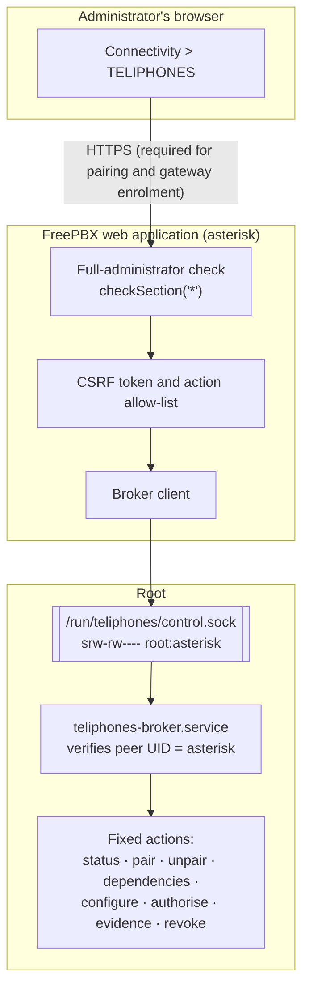
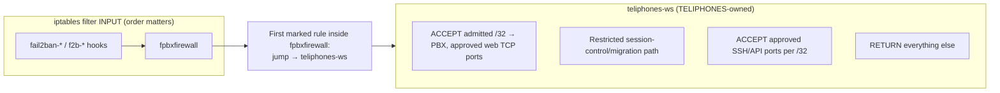

# TELIPHONES architecture

This document describes **FreePBX module 0.6.6**, **root broker 0.6.6**,
**broker protocol 12** and **Windows 0.8.4** source:
components, trust boundaries, interfaces, firewall layers and stored state.
Architecture describes the implementation, not proof of production behaviour.
See [Security and verification evidence](SECURITY.md#verification-evidence)
and the [module operating guide](../teliphones/README.md).

## Contents

- [Design principles](#design-principles)
- [Components](#components)
- [Privilege separation](#privilege-separation)
- [Administrator workstation connections](#administrator-workstation-connections)
- [Firewall layers on the PBX](#firewall-layers-on-the-pbx)
- [Broker lifecycle and reconciliation](#broker-lifecycle-and-reconciliation)
- [Remote Support sessions](#remote-support-sessions)
- [Separation of the two workflows](#separation-of-the-two-workflows)
- [Runtime files and services](#runtime-files-and-services)
- [Windows application](#windows-application)
- [What is not part of the architecture](#what-is-not-part-of-the-architecture)

## Design principles

1. **The PBX is the authority.** Access exists only while the PBX's own state says that it does. Clients, gateways and external services cannot create, extend or restore it.
2. **Explicit, narrow grants.** Every grant names a key, an address, a set of services and a lifetime. Nothing is granted by network location alone.
3. **Least privilege.** The web interface authenticates and validates requests but performs no privileged operations itself. A root-owned broker performs a fixed set of operations.
4. **Coexistence.** TELIPHONES manages only its marked objects and its FreePBX Custom Service through the supported API. It does not disable FreePBX Firewall, bypass Fail2Ban or alter unrelated routes/tables.
5. **Verify, then admit.** Firewall restrictions are verified before traffic is admitted. When verification fails, access is disabled rather than left open.
6. **Provider neutrality.** External support infrastructure is reached through published contracts, not proprietary services.

## Components

| Component | Location in repository | Runs as | Role |
|---|---|---|---|
| FreePBX module | `teliphones/` | `asterisk` (web) | GUI page, AJAX status and action endpoints, administrator checks, request validation |
| Console command | `teliphones/Console/Teliphones.class.php` | root | `fwconsole teliphones`: support lifecycle, recovery, reconciliation and baseline |
| Privileged broker | `teliphones/support_broker.py`, installed to `/usr/local/lib/teliphones-broker/` | root | Allow-listed actions: workstation pairing and revocation, `wireguard-tools` installation after approval, gateway enrolment and support orchestration |
| Root bootstrap | `teliphones/BrokerBootstrap.php`, `teliphones/install.php` | root (once per upgrade) | Installs the broker, its systemd units and private state directories |
| Windows application | `desktop/windows/` | Interactive Windows user, plus an elevated helper for tunnel installation | Pairing requests, key storage, tunnel management and opening FreePBX or SSH |
| Reference gateway | `gateway/` | Root on a separate, disposable Linux host | Lab implementation of `teliphones-connect/1`, engineer and Checker grants |
| Checker probe | `gateway/checker_probe.py` | Separate Checker host or namespace | Signs independent reachability evidence with ECDSA P-256 |

## Privilege separation



*Every request passes the FreePBX full-administrator check before anything else. Actions also require a valid CSRF token and must be on a fixed allow-list. The web application then sends a structured request over a Unix socket that only the `asterisk` group can open. The broker checks the connecting process's user ID and performs only the named operation. No shell commands or file paths are accepted from the browser.*

Key points:

- The broker is installed by a **root bootstrap**, because Module Admin runs as the web service account and cannot create root-owned files or services. The bootstrap stages the module into a root-owned directory before executing it, so root never runs code directly from the web-writable module directory.
- The broker reports protocol, component version and capabilities. Module 0.6.6 requires broker 0.6.6 even at protocol 12; missing/malformed capabilities or an older component block workstation operations.
- Pairing and revocation opt into fixed, non-secret progress frames while synchronous verification runs. PHP retains a five-second inactivity deadline; only a verified final result confirms removal. Connection loss does not cancel or redispatch the mutation. Broker 0.6.6 durably records revocation before cleanup, rejects revoked identities during recovery/admission, and exposes the latest persisted outcome separately from listener housekeeping. The superseded 0.6.5 archive was removed; historical archives lack these new security corrections; the local 0.6.6 archive includes current source. Local tests do not establish live FreePBX acceptance.
- Like other root `fwconsole` services, this design trusts the integrity of the FreePBX application code. Anyone able to execute code as the FreePBX service account can send requests to the broker.

## Administrator workstation connections

```mermaid
sequenceDiagram
    autonumber
    participant W as Windows application
    actor A as FreePBX administrator
    participant M as TELIPHONES module
    participant B as Root broker
    W->>W: Enter name, select access, generate key pair and 128-bit nonce
    W-->>A: Pairing request (v1 GUI-only; v2 adds independent SSH public identity)
    A->>M: Paste request, choose period and SSH permission (HTTPS)
    M->>B: pair
    B->>B: Allocate a /32, apply and verify the nft policy and firewall integration
    B-->>M: Pairing response values
    M-->>A: Bound response (v2 includes approved account, ports, pinned host/CA)
    A-->>W: Paste response
    W->>W: Validate current request binding, addresses, endpoint, expiry and approved SSH account; enable Save
    W->>B: WireGuard handshake on tlp-admin (UDP 51821 by default)
```

| Element | Value |
|---|---|
| PBX interface | `tlp-admin` for unlocked pairings; dedicated `tlpw...` interface for Locked pairings |
| Default UDP port | `51821` shared; Locked pairings receive a dedicated source-restricted UDP port |
| Address allocation | A `/24` from `100.64.0.0/10` (excluding `100.100.0.0/16`); the PBX is `.1` and each workstation receives a `/32` |
| Workstation route | Only the PBX's tunnel address (`/32`) |
| Services | Configured HTTP/HTTPS ports (80/443 by default), admitted only with an active session lease; approved managed SSH adds TCP 8765 and `22000 + IPv4 last octet`; legacy approvals retain 22; ICMP echo remains subject to FreePBX policy |
| Forwarding | Dropped in both directions on `tlp-admin` |
| GUI address opened by the client | First approved HTTP/HTTPS service's scheme/port on `<PBX tunnel address>/admin/`, inside the encrypted tunnel |

The request and response formats, and the client-side validation rules, are specified in the [workstation pairing contract](../teliphones/docs/WORKSTATION-PAIRING.md).

Web-only requests use v1; v2 adds an independent SSH public identity. Neither
requests approval by itself. The administrator may approve web-only even for an
SSH-capable request, but Windows requires explicit SSH approval to save with
Web + SSH selected. A web-only reply requires generating a new Web Access
request rather than silently downgrading the selected access.
Changing name/access in Windows clears the pending request,
response and unused identities and requires regeneration. Copy is available
only for a generated current request; Save revalidates its response and never
trusts a manually altered account display. The response envelope is not signed:
provenance relies on the trusted HTTPS administrator exchange, distinct from
cryptographically verified SSH session certificates.

Managed SSH uses an authenticated request/2 challenge exchange over the tunnel:
the permanent DPAPI-protected workstation identity signs a fresh session ID and
distinct ephemeral public key. The broker issues a source/principal-bound
certificate for at most 300 seconds, bounded by the pairing deadline. Windows
verifies the CA signature and pinned host, then its private agent signs once for
the owned OpenSSH child and destroys the session signing capability. The app
owns the console/helper/SSH Job; the PBX separately owns each listener's
systemd/cgroup. No ordinary SSH account/configuration is modified.
See the [key inventory and lifecycle](SSH-KEY-MANAGEMENT-PROPOSAL.md).

## Firewall layers on the PBX

Workstation traffic is subject to two independent layers. Both must permit a packet.

### Layer 1: TELIPHONES nftables table

The broker owns `inet teliphones_workstations`, identified by the exact hookless
`teliphones_owner_v1` chain, not a table comment. Its base chains run at priority -10:

```text
table inet teliphones_workstations {
    chain teliphones_owner_v1 {
    }
    chain input {
        type filter hook input priority -10; policy accept;
        iifname "tlp-admin" ip saddr <admitted /32> ip daddr <PBX> tcp dport <approved web ports> accept
        iifname "tlp-admin" ip saddr <managed-SSH /32> ip daddr <PBX> tcp dport { 8765, <peer SSH port> } accept
        iifname "tlp-admin" ip saddr <legacy-SSH /32> ip daddr <PBX> tcp dport 22 accept
        iifname "tlp-admin" ip daddr <PBX> icmp type echo-request accept
        iifname "tlp-admin" drop
    }
    chain forward {
        type filter hook forward priority -10; policy accept;
        iifname "tlp-admin" drop
        oifname "tlp-admin" drop
    }
}
```

*This is a simplified shared-interface illustration, not a loadable ruleset.
Current JSON also covers dedicated Locked interfaces, source/banned UDP rules,
management-session leases and the restricted control/migration path. The broker
compares complete kernel readback, all chains/hooks/priorities/policies/rules and
expressions. Unrelated traffic is not a blanket TELIPHONES service grant.*

### Layer 2: FreePBX Firewall integration

An nftables `accept` is final only within its own base chain, so a later FreePBX Firewall rule can still drop the packet. On a real FreePBX 17 system, FreePBX Firewall classified `tlp-admin` as `zone-external` and dropped workstation web traffic. The old jump above `fpbxfirewall` in INPUT triggered the reported "invading rule" resets. To admit only the approved traffic without competing with INPUT ordering, the broker maintains its own iptables chain, `teliphones-ws`, with one marked jump at the start of `fpbxfirewall`:



*Every INPUT Fail2Ban hook must precede entry to FreePBX Firewall, so banned addresses stay banned. The chain accepts only exact source, destination, interface and port combinations, and returns everything else to the remaining FreePBX rules unchanged. Managed SSH uses TCP 8765 and the peer's dedicated port; legacy approved SSH uses 22. SIP/RTP, AMI, databases, other ports, other sources, ICMP and IPv6 are never accepted by this chain.*

Placement rules:

- Fail2Ban hooks are recognised by the case-insensitive prefixes `fail2ban-` (as used on the FreePBX 17 test PBX) and `f2b-` (upstream Fail2Ban).
- If no `fpbxfirewall` hook exists, the status is `not-detected` and no integration is installed.
- If a Fail2Ban hook follows `fpbxfirewall`, no safe position exists. The integration is withdrawn and the status is `error`, naming the chains. Tunnel traffic is then left to FreePBX Firewall.
- The `inet teliphones_workstations` table is owned through its exact hookless `teliphones_owner_v1` marker chain, not a table comment that Debian 12 nftables 1.0.6 drops from JSON readback. An unfamiliar `teliphones-ws` chain, an unmarked rule within it or an unexpected reference is never modified, and admission is refused.
- Only the exact marked jump is edited inside `fpbxfirewall`. The exact legacy INPUT jump is removed on migration and cleanup; no INPUT rule is inserted. No unrelated rule is flushed, replaced or reordered; Custom Rules are not required.

The exact rule text, the reconciliation behaviour and the known ordering gap are documented in [FreePBX Firewall integration](../teliphones/docs/WORKSTATION-PAIRING.md#freepbx-firewall-integration).

## Broker lifecycle and reconciliation

| Event | Broker behaviour |
|---|---|
| Startup | Disables `tlp-admin`, revalidates the owned nftables policy and FreePBX Firewall integration, then restores still-valid pairings. Interrupted support sessions are revoked. Temporary deadlines are never extended. |
| Pairing or revocation | Applies and verifies policy while preserving unrelated established workstations when possible; full rebuild disables owned interfaces before mutation. New admission requires verified policy/listener rules and an active management-session lease. |
| External nftables change | A `nft monitor` stream wakes the enforcement worker. It disables the interface, revalidates and re-applies the policy, then readmits peers. |
| FreePBX Firewall reload or Fail2Ban restart | The integration is repaired without bringing peers down. With the iptables `nf_tables` backend, repair is triggered by monitor events; with `legacy`, it waits for the periodic check. |
| Periodic check (about every 15 seconds) | Fallback validation for both temporary and persistent pairings, expiry of temporary pairings, and removal of access while TELIPHONES is disabled. |
| Monitor failure | Reported as an error. The broker attempts a verified shutdown of the interface; new admission requires broker repair or restart. |
| Shutdown and uninstall | Disables and removes the interface, verifies the removal, then removes the integration and the owned table. On failure, recovery state is retained and the failure is reported. |

## Remote Support sessions

| Element | Value |
|---|---|
| Authority | A root-created session (from the GUI through the broker, or from `fwconsole teliphones authorise`) with an absolute expiry of 5 to 240 minutes |
| Interface | `wg-teliphones`, created per session |
| Address pool | `10.20.17.0/24` (an allocation pool, not a route); proposals that collide with existing addresses or routes are refused |
| Support service | A dedicated temporary `sshd` on the session address, port `22222`, with key-only authentication |
| Expiry | Scheduled with a transient `systemd-run` timer, independently of the broker and browser |
| Reboot | The original expiry is preserved; the temporary SSH service is not reopened automatically |

The session progresses through `authorise → provision → connect-confirm → attest → Checker evidence → open → Console handoff`. Revocation removes local access first, then requests remote cleanup. See the [integration guide](../teliphones/docs/INTEGRATION.md), the [contracts](../teliphones/docs/INTEGRATIONS.md) and [topologies](../teliphones/docs/TOPOLOGIES.md).

## Separation of the two workflows

| | My PBXs (workstation pairing) | Remote Support |
|---|---|---|
| Who authorises | A full FreePBX administrator on that PBX | The customer's PBX administrator or root |
| Lifetime | Temporary (60–1440 minutes) or persistent until revoked | Always temporary (5–240 minutes), absolute expiry |
| Interface | Shared `tlp-admin` or dedicated `tlpw...` | `wg-teliphones` |
| Addressing | `100.64.0.0/10` allocation | `10.20.17.0/24` allocation |
| SSH | Managed certificate service for an explicitly approved existing account; legacy v1 approval retains system TCP 22 | Temporary key-only `sshd` on port 22222 |
| External infrastructure | None; direct WireGuard to the PBX | Connect, Checker and Console implementations |
| FreePBX Firewall integration | `teliphones-ws` chain | None; support firewall policy is not changed |

Neither workflow can create, extend or revoke the other's authority.

## Runtime files and services

| Path or unit | Purpose |
|---|---|
| `/usr/local/lib/teliphones-broker/support_broker.py` | Root-owned installed copy of the broker |
| `/usr/local/lib/teliphones-broker/ssh_authority.py` | Root-owned managed certificate and listener helper; refreshed by the same bootstrap |
| `/usr/local/lib/teliphones-broker/FirewallListener.php` | Protected FreePBX Custom Service helper; persists ownership intent and verifies generated listener rules without writing kernel rules |
| `teliphones-broker.service` | Runs the broker as root |
| `teliphones-reconcile.service` | Runs `fwconsole teliphones reconcile` once at boot to reconcile support authority |
| `/run/teliphones/control.sock` | Broker control socket, `root:asterisk`, mode `0660` |
| `/var/lib/teliphones/` | Root-owned support/workstation state, recovery journals, session leases, connection policy and migrations; original pairing expiry is preserved |
| `/etc/teliphones/` | Root-only enrolment material, including the PBX workstation key `workstation-wg.key` and gateway credentials |
| `/etc/teliphones.conf`, `/etc/teliphones-connect.conf` | Root-owned configuration |
| `/var/log/teliphones.log` | Audit log of support lifecycle events written by `fwconsole teliphones` |
| `/var/log/teliphones-web.log` | Broker log of GUI-initiated actions |

## Windows application

The Windows application is a native C++17 Win32/MFC executable for Windows 10/11 x64, statically linked so that no separate runtime is required.

- **Keys:** WireGuard private keys are stored in Credential Manager/DPAPI; optional Connect Password Protection uses Argon2id/AES-256-GCM inside DPAPI. Profiles never contain private keys.
- **Profiles:** Public pairing and grant data are stored in the user's roaming application-data directory.
- **Tunnels:** Staging/installed configs contain a public bootstrap identity, not the enrolled key. After UAC and validation, a PID-bound local-only named pipe supplies the credential to the elevated helper. It opens the official service's existing WireGuardNT adapter and applies only the private-key field through the published API, without replacing peers. The pinned official DLL/header are restored from the version-matched archive; only hash-verified code in an administrator-controlled directory is loaded. Restarting the stored configuration cannot authenticate as the enrolled identity. Restrictive ACLs and owned-process controls remain.
- **SSH:** Managed My PBXs opens the built-in libvterm/ConPTY console using the protected authentication event, isolated agent and owned process job. The separate Remote Support workflow retains supported external terminal launchers. Native 0.8.1 validation remains outstanding.
- **WireGuard:** The application uses genuine WireGuard for Windows, checking its Authenticode signature. It reuses existing installations or, only after explicit user approval, downloads a reviewed official x64 MSI, verifies its pinned hash and Authenticode publisher, and invokes Windows Installer through UAC. No WireGuard binaries are bundled. The installer does not change TELIPHONES profiles or tunnel configurations. See [installation verification and limitations](../desktop/windows/README.md#secure-connectivity-and-wireguard-installation); native installation is not yet Windows-validated.
- **Monitoring:** Only one connection is active at a time. Reachability is polled through the tunnel; there is no server-pushed revocation channel.
- **Extension point:** An `IRendezvousProvider` interface exists for future endpoint resolution; only direct connection is implemented ([design note](RENDEZVOUS.md)).

See the [Windows application guide](../desktop/windows/README.md).

## What is not part of the architecture

- No managed or hosted service: there is no FreePBX UK Connect, Checker, Console, relay or rendezvous service.
- No relay or NAT traversal: the workstation must be able to reach the PBX's WireGuard UDP port directly.
- No changes to routing, DNS, NAT, forwarding defaults or FreePBX Firewall configuration.
- No IPv6 workstation connectivity.
- No clients for operating systems other than Windows.
