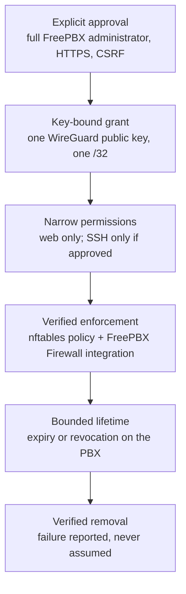

# TELIPHONES security

Security is the defining consideration for TELIPHONES. This document explains the security model of version 0.3.0 in accessible terms, states the assurance behind each control and records the known limitations honestly.

> [!WARNING]
> TELIPHONES 0.3.0 is experimental. The controls below describe what TELIPHONES is **designed** to enforce. Most have been tested only with automated tests and simulated environments. Treat them as security guarantees only once the corresponding live and adversarial tests have passed. Do not use TELIPHONES on a production PBX.

## Contents

- [Assurance levels](#assurance-levels)
- [Security model at a glance](#security-model-at-a-glance)
- [Explicit administrator authorisation](#explicit-administrator-authorisation)
- [WireGuard keys and tunnel isolation](#wireguard-keys-and-tunnel-isolation)
- [Per-workstation permissions and SSH](#per-workstation-permissions-and-ssh)
- [Temporary and persistent access](#temporary-and-persistent-access)
- [Firewall enforcement](#firewall-enforcement)
- [Revocation and expiry](#revocation-and-expiry)
- [Broker privilege separation](#broker-privilege-separation)
- [Failure handling and recovery](#failure-handling-and-recovery)
- [Remote Support controls](#remote-support-controls)
- [What TELIPHONES does not protect against](#what-teliphones-does-not-protect-against)
- [Known limitations](#known-limitations)
- [Operational guidance](#operational-guidance)
- [Reporting security issues](#reporting-security-issues)

## Assurance levels

This documentation uses three levels of assurance. A control at one level should not be described as if it had reached a higher one.

| Level | Meaning |
|---|---|
| **Design** | The intended behaviour, implemented in code and reviewed, without specific test evidence |
| **Locally tested** | Exercised by automated tests: unit tests with simulated system commands, or real packets in disposable Linux network namespaces with a **simulated** FreePBX firewall layout |
| **Verified on a real PBX** | Observed on the Debian 12 / FreePBX 17 test PBX or on real Windows |

| Control | Design | Locally tested | Verified on a real PBX |
|---|---|---|---|
| Full-administrator and CSRF checks on the GUI | ✅ | ✅ Framework stubs | Partly: GUI operation confirmed; delegated-user refusal outstanding |
| Root broker installation, ownership and socket permissions | ✅ | ✅ | ✅ Bootstrap verified (earlier release) |
| Pairing request and response binding | ✅ | ✅ PHP, Python and C++ contract tests | — |
| Workstation nftables policy verification and monitoring | ✅ | ✅ Real nftables in namespaces | — |
| FreePBX Firewall integration (`teliphones-ws`) | ✅ | ✅ Real packets, simulated FreePBX Firewall, both iptables backends | **Outstanding** |
| Fail2Ban ordering preservation | ✅ | ✅ Simulated, using observed chain names | **Outstanding** |
| SSH permitted only when approved | ✅ | ✅ | **Outstanding** (including PuTTY) |
| Unauthorised PBX services inaccessible through the tunnel | ✅ | ✅ SIP, AMI, MySQL and IPv6 in simulation | **Outstanding** |
| Revocation, expiry and verified uninstall | ✅ | ✅ Including failure injection | **Outstanding** |
| Remote Support session lifecycle and Checker evidence | ✅ | ✅ Module tests; reference gateway laboratory available | **Outstanding** |

## Security model at a glance

*Each step depends on the previous one. Access starts with an explicit approval tied to a single key. That approval is limited to specific services, enforced by firewall rules that are verified before traffic is admitted, and ends when it expires or is revoked. Its removal is verified.*

## Explicit administrator authorisation

- Installing or enabling TELIPHONES grants **no** access.
- The TELIPHONES page and its AJAX endpoints require a FreePBX administrator with full access (`checkSection('*')`). Restricted users, missing or malformed sessions and unavailable permission checks are refused.
- Every action requires a valid CSRF token and must appear on a fixed allow-list.
- Workstation pairing and gateway enrolment are refused unless the page is served over HTTPS, because a pairing request names the key that will be admitted.
- Support sessions require a root-level decision: either the GUI action carried out by the root broker, or `fwconsole teliphones authorise` from a root shell. External systems cannot authorise a session.

## WireGuard keys and tunnel isolation

- **Workstation keys** are generated by the Windows application and stored in Windows Credential Manager. Only the public key leaves the workstation.
- **The PBX's workstation key** (`/etc/teliphones/workstation-wg.key`) is generated on the PBX and stored root-only.
- **Support session keys** for the PBX are generated on the PBX and never leave it.
- **Binding:** the pairing response echoes the request's random nonce and the workstation's public key. The Windows application rejects responses that do not match its own pending request, or that contain unexpected fields, addresses, endpoints or GUI addresses.
- **Isolation:** the workstation routes only the PBX's `/32`. On the PBX, all forwarding to and from `tlp-admin` is dropped, so a workstation cannot use the PBX to reach other networks. Workstation and support traffic use separate interfaces and address ranges.
- **Pairing responses** contain public keys and network metadata, not private keys. Treat them as sensitive operational data nonetheless.

## Per-workstation permissions and SSH

| Traffic from a paired workstation | Result |
|---|---|
| TCP 80 and 443 to the PBX tunnel address | Permitted |
| TCP 22 to the PBX tunnel address | Permitted **only** if that workstation was approved for SSH |
| ICMP echo request to the PBX tunnel address | Permitted by TELIPHONES' nftables table; still subject to FreePBX Firewall |
| SIP, IAX, AMI, ARI, databases, provisioning and every other port | Dropped by TELIPHONES' nftables table |
| Any destination other than the PBX tunnel address, including forwarding | Dropped |
| IPv6 on `tlp-admin` | Dropped |

SSH approval admits the PBX's **existing** SSH service, with the PBX's existing accounts and authentication policy. Pairing creates no accounts, passwords or keys, and does not change SSH configuration. The `Linux SSH account` field in the Windows application only selects the user name for **Open SSH**.

## Temporary and persistent access

- **Temporary pairings** carry an absolute expiry, set on the PBX when they are approved. Reconnection, broker restarts and upgrades never extend it, and expired entries are not restored.
- **Persistent pairings** remain valid until revoked. They are subject to exactly the same enforcement verification, monitoring and periodic checks as temporary pairings.
- **Disabling TELIPHONES** removes workstation network access during the next reconciliation and prevents its restoration. Pairing metadata is retained so that still-valid pairings can be restored after re-enabling, again without extending expiry.

## Firewall enforcement

### TELIPHONES-owned nftables table

- The broker manages only `inet teliphones_workstations`, identified by the exact comment `TELIPHONES workstation enforcement v1`.
- Before any peer is admitted, the broker reads back the complete kernel table and compares it with the expected policy: its chains, hooks, priorities, policies, every rule and every expression. Extra or altered content fails verification.
- A table with the same name but without the TELIPHONES marker is treated as unfamiliar. It is never overwritten or deleted, and workstation access stays disabled until a root administrator has investigated it.
- External changes are detected through a local `nft monitor` stream, with a periodic check about every 15 seconds as a fallback. When a change is detected, the interface is disabled, the policy is restored and verified, and only then are peers readmitted.

### FreePBX Firewall integration

- The broker maintains the `teliphones-ws` iptables chain and one marked `INPUT` jump, placed after every Fail2Ban hook and immediately before `fpbxfirewall`.
- The chain accepts only TCP 80/443, plus TCP 22 for SSH-approved workstations, from each active paired `/32` to the PBX tunnel address on `tlp-admin`. Everything else returns to FreePBX Firewall.
- The integration is installed only after the nftables policy has been verified, and before the interface is brought up.
- FreePBX Firewall chains, zones, trusted networks, settings and services are never modified. The interface is not added to a trusted zone, and the workstation subnet is not trusted, because either would admit every service.
- If Fail2Ban's hooks cannot all precede the integration, TELIPHONES withdraws the integration rather than bypass Fail2Ban. Tunnel web traffic is then dropped by FreePBX Firewall until the ordering is corrected.
- `ip6tables` is never modified.

### What TELIPHONES never does

TELIPHONES never flushes the system ruleset, deletes or edits FreePBX Firewall or Fail2Ban chains, changes default firewall policies, enables, disables or restarts firewall services, modifies unrelated nftables tables, or changes routing, DNS, NAT or forwarding defaults.

## Revocation and expiry

- An administrator can revoke one workstation or all workstations from **Windows workstations**. Before changing anything, revocation disables `tlp-admin` and verifies that it is down.
- Revocation is reported as successful only once it has been verified. A failed revocation is reported as an error, and **Revoke all workstations** remains available for retry.
- Temporary pairings are removed on expiry by the broker's periodic check, approximately every 15 seconds.
- The Windows application learns of revocation by losing reachability. There is no server-pushed revocation channel, so a client may briefly continue to show a connection. The PBX remains authoritative.
- Deleting a Windows profile does **not** revoke a pairing. Revoke on the PBX first.

## Broker privilege separation

- The web application runs as `asterisk` and performs no privileged operations.
- The broker is installed by a root bootstrap. The bootstrap copies the module into a root-owned staging directory and runs it from there, so root never executes files from the web-writable module directory.
- The control socket `/run/teliphones/control.sock` is `root:asterisk`, mode `0660`. The broker verifies that each connecting process belongs to the FreePBX service account.
- The broker accepts structured requests for a fixed set of actions only. It accepts no shell commands or file paths from the browser.
- Package installation is limited to `wireguard-tools`, only after an administrator explicitly approves it, and uses Debian's configured repositories. Nothing is installed when a page loads.
- Like other root-capable FreePBX services, the design relies on the integrity of FreePBX application code. **Do not allow untrusted code to run as the FreePBX service account.**

## Failure handling and recovery

| Failure | Behaviour |
|---|---|
| nftables policy cannot be verified | Workstation access is disabled; peers are not admitted |
| Unfamiliar nftables table or `teliphones-ws` chain | Not modified; access stays disabled; the conflict is reported |
| FreePBX Firewall hook missing | Integration status `not-detected`; no integration rules are installed |
| Fail2Ban hook after `fpbxfirewall` | Integration withdrawn; status `error`; Fail2Ban is not bypassed |
| Interface cannot be disabled or deleted | Reported as an error; the restrictive firewall rules, key and pairing data are retained rather than removed |
| Monitor stream fails | Reported; the broker attempts a verified interface shutdown, and new admission requires repair |
| Uninstall cannot verify cleanup | Uninstall aborts and keeps recovery information; it never silently leaves an unrestricted interface |
| Broker restarts during a support session | The session is revoked and TELIPHONES is quarantined; SSH is not silently reopened |
| Support session operation fails | Local authority is revoked and the module is quarantined |

## Remote Support controls

- Sessions have an absolute expiry of 5 to 240 minutes, scheduled with `systemd-run` independently of the broker and the browser.
- Proposed addressing is checked against existing addresses and routes, and collisions are refused. TELIPHONES does not change routes, DNS, forwarding or NAT to make a proposal fit.
- Engineer access is not opened until TELIPHONES has verified local state and accepted Checker evidence. That evidence must be signed with the pinned ECDSA P-256 key and be bound to the session, topology, nonce and validity period. Replayed or stale evidence is rejected.
- The temporary SSH service listens only on the session address, port `22222`. It accepts only session-specific public keys and disables password, keyboard-interactive and PAM authentication, TCP, agent and X11 forwarding, tunnelling, gateway ports and user environment processing.
- Revocation removes local access first (the SSH service and its processes, keys and interface), then requests remote cleanup.
- The reference gateway uses mutual TLS, replay-protected request identifiers and nftables element timeouts that never outlast the session. It is a laboratory reference only.

## What TELIPHONES does not protect against

- A compromised PBX root account, or another privileged process that deliberately alters the firewall.
- Code running as the FreePBX service account, which can use the broker as an administrator would.
- A compromised Windows workstation or Windows user account holding the WireGuard key.
- Weak FreePBX or SSH credentials. TELIPHONES restricts who can reach the services, but it does not replace their authentication.
- Exposure of the WireGuard UDP port itself. It must be reachable; WireGuard does not respond to unauthenticated packets.

## Known limitations

- **External firewall flushes.** TELIPHONES detects and repairs external changes; it cannot prevent them. A privileged process that flushes or replaces the firewall can expose an active tunnel until the change is detected. A transient removal can pass traffic even if the rules are restored before detection. There is no guaranteed detection latency under load or resource exhaustion. This is **not** fail-closed or zero-exposure protection.
- **Fail2Ban ordering gap.** If a firewall reload or Fail2Ban inserts a Fail2Ban hook between the TELIPHONES jump and `fpbxfirewall`, traffic that TELIPHONES has approved for paired workstations reaches the TELIPHONES chain before that hook. The hook can be bypassed until reconciliation moves the jump: this is prompt with the iptables `nf_tables` backend, and can take up to about 15 seconds with `legacy`. There is also a race if a hook is inserted at the same moment as the integration; the result is read back, and an invalid result is corrected or withdrawn.
- **Assumed FreePBX hook names.** The names `fpbxfirewall`, `fail2ban-*` and `f2b-*` come from the reported FreePBX 17 test installation and upstream defaults, not from FreePBX source code. Fail2Ban hooks reached through other chains, and Fail2Ban's own nftables tables, are not inspected.
- **IPv4 only.** Workstation connectivity and the FreePBX Firewall integration are IPv4-only.
- **No revocation push to Windows.** Clients detect revocation through lost reachability.
- **Root SSH for Remote Support.** The temporary support SSH service uses root with session-specific keys. A narrower support account model has not yet been designed.
- **Remote Support firewall policy.** Support-session reachability with FreePBX Firewall enabled is unknown, and TELIPHONES does not change the support firewall policy.
- **Real-world verification.** End-to-end workstation connectivity with FreePBX Firewall enabled, firewall reload behaviour, Fail2Ban enforcement during reordering, SSH through PuTTY and the inaccessibility of unauthorised services all remain to be verified on a real PBX. See [outstanding verification](../teliphones/README.md#outstanding-030-verification).

## Operational guidance

- Never disable FreePBX Firewall, add `tlp-admin` to a trusted zone or trust the workstation subnet to make a connection work. Use the [troubleshooting guide](../teliphones/README.md#troubleshooting) instead.
- Never weaken SSH configuration, change the socket's ownership or mode, or loosen state-directory permissions to resolve a problem.
- Never flush the firewall ruleset to resolve a TELIPHONES conflict.
- Approve SSH only for workstations that need it. Prefer temporary pairings where possible.
- Revoke on the PBX before deleting a Windows profile. Revoke pairings promptly when a workstation is lost, retired or reassigned.
- Run the root bootstrap after every upgrade, so that the installed broker matches the module.
- Do not post pairing requests or responses, gateway grants, logs containing them, or any private key in public issues or support requests.

## Reporting security issues

Please report suspected security vulnerabilities privately through [FreePBX UK support](https://freepbx.uk/support/), rather than in a public issue. Include the TELIPHONES, FreePBX and Debian versions, the affected workflow and the steps needed to reproduce the issue. Do not include private keys, credentials, pairing responses or other session secrets.
