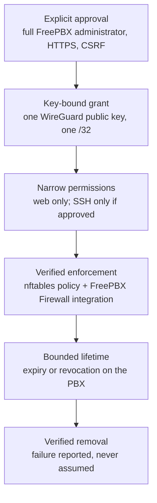

# TELIPHONES security

This document explains current source targets **FreePBX module 0.6.6**, **root
broker 0.6.6**, **protocol 12** and **Windows 0.8.4**, evidence and limitations.

> [!WARNING]
> TELIPHONES remains experimental. The operator reports successful native
> Windows tests and initial live authenticated SSH, not complete lifecycle
> assurance. The latest 0.8.4 source still requires native Windows validation,
> and current firewall/session recovery requires live-PBX acceptance.
> Do not use TELIPHONES on a production PBX.

## Contents

- [Assurance levels](#assurance-levels)
- [Verification evidence](#verification-evidence)
- [Security model at a glance](#security-model-at-a-glance)
- [Explicit administrator authorisation](#explicit-administrator-authorisation)
- [WireGuard keys and tunnel isolation](#wireguard-keys-and-tunnel-isolation)
- [Per-workstation permissions and SSH](#per-workstation-permissions-and-ssh)
- [Temporary and persistent access](#temporary-and-persistent-access)
- [Firewall enforcement](#firewall-enforcement)
- [Revocation and expiry](#revocation-and-expiry)
- [Broker privilege separation](#broker-privilege-separation)
- [Failure handling and recovery](#failure-handling-and-recovery)
- [Remote Support controls](#remote-support-controls)
- [What TELIPHONES does not protect against](#what-teliphones-does-not-protect-against)
- [Known limitations](#known-limitations)
- [Operational guidance](#operational-guidance)
- [Reporting security issues](#reporting-security-issues)

## Assurance levels

This documentation uses three levels of assurance. A control at one level should not be described as if it had reached a higher one.

| Level | Meaning |
|---|---|
| **Design** | The intended behaviour, implemented in code and reviewed, without specific test evidence |
| **Locally tested** | Exercised by automated tests: unit tests with simulated system commands, or real packets in disposable Linux network namespaces with a **simulated** FreePBX firewall layout |
| **Operator-reported native/live observation** | Reported from Windows or the Debian 12 / FreePBX 17 test PBX; not independently reproduced in this workspace |

| Control | Design | Locally tested | Native/live observation |
|---|---|---|---|
| Full-administrator and CSRF checks on the GUI | ✅ | ✅ Framework stubs | Partly: GUI operation confirmed; delegated-user refusal outstanding |
| Root broker installation, ownership and socket permissions | ✅ | ✅ | ✅ Bootstrap verified (earlier release) |
| Pairing request and response binding | ✅ | ✅ PHP, Python and C++ contract tests | — |
| Workstation nftables policy verification and monitoring | ✅ | ✅ Real nftables in namespaces | — |
| FreePBX Firewall integration (`teliphones-ws`) | ✅ | ✅ Real packets, simulated FreePBX Firewall, both iptables backends | **Outstanding** |
| Fail2Ban ordering preservation | ✅ | ✅ Simulated, using observed chain names | **Outstanding** |
| Managed SSH authentication and client disconnect | ✅ | ✅ Linux OpenSSH and portable contracts | Operator reports earlier 11/11 and first-run startup smoke passing; not current 0.8.1 validation |
| SSH refusal for unapproved peers and complete server lifecycle | ✅ | ✅ | **Outstanding** on the real PBX; PuTTY is not supported for managed SSH |
| Unauthorised PBX services inaccessible through the tunnel | ✅ | ✅ SIP, AMI, MySQL and IPv6 in simulation | **Outstanding** |
| Revocation, expiry and verified uninstall | ✅ | ✅ Including failure injection | **Outstanding** |
| Remote Support session lifecycle and Checker evidence | ✅ | ✅ Module tests; reference gateway laboratory available | **Outstanding** |

## Verification evidence

This evidence register is reviewed on **5 November 2026**. It distinguishes
supplied reports, current source and preserved packages from local execution.
Earlier failed runs remain in the [Windows readiness history](../desktop/windows/tests/WINDOWS-READINESS.md#historical-investigations);
they are not the current native-test result.

| Evidence source | Result and boundary |
|---|---|
| Current source review | Windows 0.8.4 corrects the tunnel lifecycle: verified cleanup, per-tunnel exclusion of elevated helpers, original-error reporting and termination of a stuck `START_PENDING` service's own `wireguard.exe` only after SCM binary path and process image prove ownership (PID reuse excluded); other WireGuard tunnels are never changed, and a process blocked in kernel mode still requires a Windows restart. It retains 0.8.3's replacement of the incompatible text-UAPI pipe introduced in 0.8.0 with the official WireGuardNT adapter API. The official 1.1 archive/DLL/header hashes and AMD64 exports/imports were inspected locally. The private-only update preserves peers; PID-bound delivery, bootstrap-only disk configuration and fail-closed cleanup remain. Native compilation, SCM regressions, actual official service/driver activation, MFC dialogue and startup smoke are CI gates, not executed in this Linux workspace. Native build and artefact creation remain pending; no connectivity success is claimed. |
| Pairing form source correction | Disabled SSH select omitted `ssh` from web-only POST. The module now submits explicit `ssh=0`, retains safe values and rejects missing/invalid choices. PHP/Node page-path tests passed; gateway suite 203 run, 202 passed, one skipped, includes actual PHP page/Unix-socket broker pairing with modelled network commands. This is not live PBX execution. |
| Current and preserved packages | Module/broker 0.6.6 source corrects the nftables feedback loop that blocked session admission, retaining 0.6.5 durable workstation revocation, verified enforcement and retrievable outcomes; the local 0.6.6 archive and checksum include current source; no release or deployment is claimed. The superseded 0.6.5 archive was removed; historical archives lack these new security fixes. Exact archive/source equality is a local packaging check, not proof of live connectivity. Windows is independently 0.8.4. |
| nftables repeatability | At 0.6.3 preparation, 10/10 working-tree and 10/10 unchanged-baseline namespace runs passed after an earlier intermittent own-event-filtering failure. That failure remains undiagnosed; successful samples do not exclude recurrence. |
| Later operator report | Earlier Windows Actions run: all eleven native SSH integrations passed; first-run GUI smoke subsequently reported successful. No matching 0.8.1 run or independently fetched evidence is supplied. |
| Operator's latest report | Successful Windows GitHub Actions builds and **all ten native OpenSSH integration tests passing**. No run URL, commit/build hash or raw logs accompanied this update; no external service was queried to verify it. |
| Operator's live test | Windows 0.7.0 authenticated to a FreePBX 17 / Debian 12 server with installed module 0.4.0; the owned SSH terminal closed automatically on disconnect. This establishes an initial interoperability milestone, not complete PBX-side termination. |
| Local 0.4.1 correction tests | Gateway suite: 148 run, 147 passed, one skipped because `wg` was absent. Includes genuine OpenSSH in isolated Linux namespaces and real packets through both iptables backends with simulated FreePBX rules; the SSH supervisor substitutes for systemd/cgroups. Module PHP/JS/docs, portable Windows 7/7 CTest and archive validation passed at packaging. |
| Preserved review archive | `TELIPHONES-0.4.1.tgz` includes the corrected broker. Subsequent documentation-only edits are not repackaged; full archive/source byte equality must be re-established before a future distribution. |
| Not established | Real 0.4.1 FreePBX watchdog/rebuild stability; full revocation/expiry and empty cgroups; reboot, broker failure, recovery, upgrade/rollback/uninstall; complete terminal/display matrix; Remote Support end to end; production readiness. |

Certificate expiry refuses **new authentication**. It does not kill an
already authenticated SSH process. Termination relies on the owned Windows Job
and, independently, PBX pairing authority and per-workstation systemd/cgroup
controls. Observing the terminal close does not verify the PBX cgroup is empty,
nor prove revocation, authorisation expiry or unrelated-session preservation.

For acceptance steps and remaining real-PBX tests, use
[module verification status](../teliphones/README.md#current-verification-status),
[testing](../teliphones/docs/TESTING.md#041-firewall-correction) and
[firewall diagnostics](FREEPBX-FIREWALL-DIAGNOSTICS.md).

## Security model at a glance

*Each step depends on the previous one. Access starts with an explicit approval tied to a single key. That approval is limited to specific services, enforced by firewall rules that are verified before traffic is admitted, and ends when it expires or is revoked. Its removal is verified.*

## Explicit administrator authorisation

- Installing or enabling TELIPHONES grants **no** access.
- The TELIPHONES page and its AJAX endpoints require a FreePBX administrator with full access (`checkSection('*')`). Restricted users, missing or malformed sessions and unavailable permission checks are refused.
- Every action requires a valid CSRF token and must appear on a fixed allow-list.
- Workstation pairing and gateway enrolment are refused unless the page is served over HTTPS, because a pairing request names the key that will be admitted.
- Support sessions require a root-level decision: either the GUI action carried out by the root broker, or `fwconsole teliphones authorise` from a root shell. External systems cannot authorise a session.

## WireGuard keys and tunnel isolation

- **Workstation keys** are generated by the Windows application and stored in Windows Credential Manager. Only the public key leaves the workstation.
- **The PBX's workstation key** (`/etc/teliphones/workstation-wg.key`) is generated on the PBX and stored root-only.
- **Support session keys** for the PBX are generated on the PBX and never leave it.
- **Binding:** the pairing response echoes the request's random nonce and the workstation's public key. The Windows application rejects responses that do not match its own pending request, or that contain unexpected fields, addresses, endpoints or GUI addresses.
- **Isolation:** the workstation routes only the PBX's `/32`. On the PBX, all forwarding to and from `tlp-admin` is dropped, so a workstation cannot use the PBX to reach other networks. Workstation and support traffic use separate interfaces and address ranges.
- **Pairing responses** contain public keys and network metadata, not private keys. Treat them as sensitive operational data nonetheless.

## Per-workstation permissions and SSH

| Traffic from a paired workstation | Result |
|---|---|
| TCP 80 and 443 to the PBX tunnel address | Permitted |
| TCP 8765 and that peer's `22000 + IPv4 last octet` listener | Managed SSH-approved peers only: authenticated certificate API and isolated SSH service |
| TCP 22 to the PBX tunnel address | Legacy version-1 SSH-approved pairings only; not granted to managed pairings |
| ICMP echo request to the PBX tunnel address | Permitted by TELIPHONES' nftables table; still subject to FreePBX Firewall |
| SIP, IAX, AMI, ARI, databases, provisioning and every other port | Dropped by TELIPHONES' nftables table |
| Any destination other than the PBX tunnel address, including forwarding | Dropped |
| IPv6 on `tlp-admin` | Dropped |

Managed SSH approval names an **existing Linux account**, never an implicit root
account. Pairing creates no account and does not alter system SSH configuration.
The broker owns a separate CA/host identity and per-workstation listener. It
checks the account's effective policy and refuses unsupported Match, MFA or
forced-command constraints rather than weakening them.

Windows holds a DPAPI-encrypted permanent workstation signing identity,
separate from its WireGuard key. For every SSH launch it creates an in-memory
ephemeral key. The permanent identity signs a one-use challenge, fresh session
ID and distinct ephemeral public key for the request/2 API. The certificate is
limited to that key/source/principal, at most 300 seconds and the original
pairing expiry. Windows verifies the CA signature and pinned host identity;
there is no password, shared-agent or host-acceptance fallback.

The owned Windows OpenSSH process receives one account/certificate-bound
authentication signature via a private process-bound agent; the disposable
signing capability is then destroyed. This does not guarantee physical erasure
from memory, paging files, crash dumps or storage, or resist a compromised OS,
administrator or pre-existing privileged handles. Full details are in the
[managed SSH implementation reference](SSH-KEY-MANAGEMENT-PROPOSAL.md).
Current My PBXs uses the built-in libvterm/ConPTY console over Windows system
OpenSSH, including PTY/input/resize and protected per-session authentication-event
handling. PuTTY is unsupported for managed certificates; external terminal
preferences belong to Remote Support and the earlier helper paths. Current
0.8.1 native validation remains outstanding.

## Temporary and persistent access

- **Temporary pairings** carry an absolute expiry, set on the PBX when they are approved. Reconnection, broker restarts and upgrades never extend it, and expired entries are not restored.
- **Persistent pairings** remain valid until revoked. They are subject to exactly the same enforcement verification, monitoring and periodic checks as temporary pairings.
- **Disabling TELIPHONES** removes workstation network access during the next reconciliation and prevents its restoration. Pairing metadata is retained so that still-valid pairings can be restored after re-enabling, again without extending expiry.

## Firewall enforcement

### TELIPHONES-owned nftables table

- The broker manages only `inet teliphones_workstations`, identified by the exact hookless `teliphones_owner_v1` chain. It does not rely on table comments, which Debian 12 nftables 1.0.6 omits from kernel JSON readback.
- Before any peer is admitted, the broker reads back the complete kernel table and compares it with the expected policy: its chains, hooks, priorities, policies, every rule and every expression. Extra or altered content fails verification.
- A table with the same name but without the TELIPHONES owner chain is treated as unfamiliar, except for a one-time migration of the exact known 0.3.0 policy while the interface is verified down. Altered or unrecognised tables are never overwritten or deleted, and workstation access stays disabled until a root administrator has investigated them.
- External changes are detected through a local `nft monitor` stream, with a periodic check about every 15 seconds as a fallback. When a change is detected, the interface is disabled, the policy is restored and verified, and only then are peers readmitted.

### FreePBX Firewall integration

- The broker maintains the `teliphones-ws` iptables chain and one marked jump at the start of `fpbxfirewall`. Every direct INPUT Fail2Ban hook must precede entry. No rule is inserted above FreePBX's INPUT hook: that old placement triggered the reported recurring "invading rule" resets.
- The chain accepts only configured management TCP ports (default 80/443) and approved SSH ports from admitted peers to their PBX address on the shared/dedicated interface. Management requires an active session lease. Managed certificate SSH uses TCP 8765 and a per-peer listener, never system TCP 22; legacy approvals retain 22. Everything else returns to the remaining FreePBX rules.
- The integration is installed only after the nftables policy has been verified, and before the interface is brought up.
- Only the exact marked jump is changed inside `fpbxfirewall`; the exact legacy INPUT jump is removed during migration/cleanup. A TELIPHONES Custom Service manages the required UDP listener ports through FreePBX's API and verifies generated rules. Unrelated zones/rules/services remain unchanged. Custom Rules need not be enabled; the interface/subnet are not trusted.
- If Fail2Ban's hooks cannot all precede the integration, TELIPHONES withdraws the integration rather than bypass Fail2Ban. Tunnel web traffic is then dropped by FreePBX Firewall until the ordering is corrected.
- `ip6tables` is never modified.

### What TELIPHONES never does

TELIPHONES never flushes the system ruleset or a foreign chain, deletes/replaces unrelated FreePBX Firewall or Fail2Ban rules, changes default firewall policies, enables, disables or restarts firewall services, modifies unrelated nftables tables, or changes routing, DNS, NAT or forwarding defaults.

## Revocation and expiry

- An administrator can revoke one workstation or all workstations from **Windows workstations**. Before changing anything, revocation disables `tlp-admin` and verifies that it is down.
- Revocation is reported as successful only once it has been verified. A failed revocation is reported as an error, and **Revoke all workstations** remains available for retry.
- Temporary pairings are removed on expiry by the broker's periodic check, approximately every 15 seconds.
- The Windows application learns of revocation by losing reachability. There is no server-pushed revocation channel, so a client may briefly continue to show a connection. The PBX remains authoritative.
- Deleting a Windows profile does **not** revoke a pairing. Revoke on the PBX first.

## Broker privilege separation

- The web application runs as `asterisk` and performs no privileged operations.
- The broker is installed by a root bootstrap. The bootstrap copies the module into a root-owned staging directory and runs it from there, so root never executes files from the web-writable module directory.
- The control socket `/run/teliphones/control.sock` is `root:asterisk`, mode `0660`. The broker verifies that each connecting process belongs to the FreePBX service account.
- The broker accepts structured requests for a fixed set of actions only. It accepts no shell commands or file paths from the browser.
- Package installation is limited to `wireguard-tools`, only after an administrator explicitly approves it, and uses Debian's configured repositories. Nothing is installed when a page loads.
- Like other root-capable FreePBX services, the design relies on the integrity of FreePBX application code. **Do not allow untrusted code to run as the FreePBX service account.**

## Failure handling and recovery

On missing monitor acknowledgement, pending transactions may be released only
after kernel readback verifies the resulting owned state; unavailable readback
retains pending state and blocks admission. Pairing progress conveys liveness,
not success. Response loss leaves the operation outcome unconfirmed; refresh
status before retrying and never automatically redispatch a mutation.
Broker exception reporting is bounded to safe stages, categories and source
locations; request/credential contents are not logged by that reporting path.

| Failure | Behaviour |
|---|---|
| nftables policy cannot be verified | Workstation access is disabled; peers are not admitted |
| Unfamiliar nftables table or `teliphones-ws` chain | Not modified; access stays disabled; the conflict is reported |
| FreePBX Firewall hook missing | Integration status `not-detected`; no integration rules are installed |
| Fail2Ban hook after `fpbxfirewall` | Integration withdrawn; status `error`; Fail2Ban is not bypassed |
| Interface cannot be disabled or deleted | Reported as an error; the restrictive firewall rules, key and pairing data are retained rather than removed |
| Monitor stream fails | Reported; the broker attempts a verified interface shutdown, and new admission requires repair |
| Uninstall cannot verify cleanup | Uninstall aborts and keeps recovery information; it never silently leaves an unrestricted interface |
| Broker restarts during a support session | The session is revoked and TELIPHONES is quarantined; SSH is not silently reopened |
| Support session operation fails | Local authority is revoked and the module is quarantined |

## Remote Support controls

- Sessions have an absolute expiry of 5 to 240 minutes, scheduled with `systemd-run` independently of the broker and the browser.
- Proposed addressing is checked against existing addresses and routes, and collisions are refused. TELIPHONES does not change routes, DNS, forwarding or NAT to make a proposal fit.
- Engineer access is not opened until TELIPHONES has verified local state and accepted Checker evidence. That evidence must be signed with the pinned ECDSA P-256 key and be bound to the session, topology, nonce and validity period. Replayed or stale evidence is rejected.
- The temporary SSH service listens only on the session address, port `22222`. It accepts only session-specific public keys and disables password, keyboard-interactive and PAM authentication, TCP, agent and X11 forwarding, tunnelling, gateway ports and user environment processing.
- Revocation removes local access first (the SSH service and its processes, keys and interface), then requests remote cleanup.
- The reference gateway uses mutual TLS, replay-protected request identifiers and nftables element timeouts that never outlast the session. It is a laboratory reference only.

## What TELIPHONES does not protect against

- A compromised PBX root account, or another privileged process that deliberately alters the firewall.
- Code running as the FreePBX service account, which can use the broker as an administrator would.
- A compromised Windows workstation or Windows user account holding the WireGuard key.
- Weak FreePBX credentials, legacy/system SSH credentials or unsafe approved
  account privileges. Managed SSH adds certificate authentication, not protection
  against a compromised authorised account or application.
- Exposure of the WireGuard UDP port itself. It must be reachable; WireGuard does not respond to unauthenticated packets.

## Known limitations

- **External firewall flushes.** TELIPHONES detects and repairs external changes; it cannot prevent them. A privileged process that flushes or replaces the firewall can expose an active tunnel until the change is detected. A transient removal can pass traffic even if the rules are restored before detection. There is no guaranteed detection latency under load or resource exhaustion. This is **not** fail-closed or zero-exposure protection.
- **Fail2Ban ordering gap.** A Fail2Ban INPUT hook externally moved after `fpbxfirewall` can be bypassed for approved flows until reconciliation withdraws integration. Hooks inserted before `fpbxfirewall` remain ahead of the internal jump without a repair window. The result is read back and an invalid concurrent change causes withdrawal. Monitor wakeups and periodic checks are not a guaranteed recovery deadline.
- **Assumed FreePBX hook names.** The names `fpbxfirewall`, `fail2ban-*` and `f2b-*` come from the reported FreePBX 17 test installation and upstream defaults, not from FreePBX source code. Fail2Ban hooks reached through other chains, and Fail2Ban's own nftables tables, are not inspected.
- **IPv4 only.** Workstation connectivity and the FreePBX Firewall integration are IPv4-only.
- **No revocation push to Windows.** Clients detect revocation through lost reachability.
- **Root SSH for Remote Support.** The temporary support SSH service uses root with session-specific keys. A narrower support account model has not yet been designed.
- **Remote Support firewall policy.** Support-session reachability with FreePBX Firewall enabled is unknown, and TELIPHONES does not change the support firewall policy.
- **Real-world verification.** Initial native/live SSH success is
  operator-reported. The 0.4.1 watchdog fix, package upgrade/recovery, live
  Fail2Ban ordering, complete server lifecycle and adversarial security testing
  remain incomplete. See [current verification status](../teliphones/README.md#current-verification-status).

## Operational guidance

- Never disable FreePBX Firewall, add `tlp-admin` to a trusted zone or trust the workstation subnet to make a connection work. Use the [troubleshooting guide](../teliphones/README.md#troubleshooting) instead.
- Never weaken SSH configuration, change the socket's ownership or mode, or loosen state-directory permissions to resolve a problem.
- Never flush the firewall ruleset to resolve a TELIPHONES conflict.
- Approve SSH only for workstations that need it. Prefer temporary pairings where possible.
- Revoke on the PBX before deleting a Windows profile. Revoke pairings promptly when a workstation is lost, retired or reassigned.
- Run the root bootstrap after every upgrade, so that the installed broker matches the module.
- Do not post pairing requests or responses, gateway grants, logs containing them, or any private key in public issues or support requests.

## Reporting security issues

Please report suspected security vulnerabilities privately through [FreePBX UK support](https://freepbx.uk/support/), rather than in a public issue. Include the TELIPHONES, FreePBX and Debian versions, the affected workflow and the steps needed to reproduce the issue. Do not include private keys, credentials, pairing responses or other session secrets.
